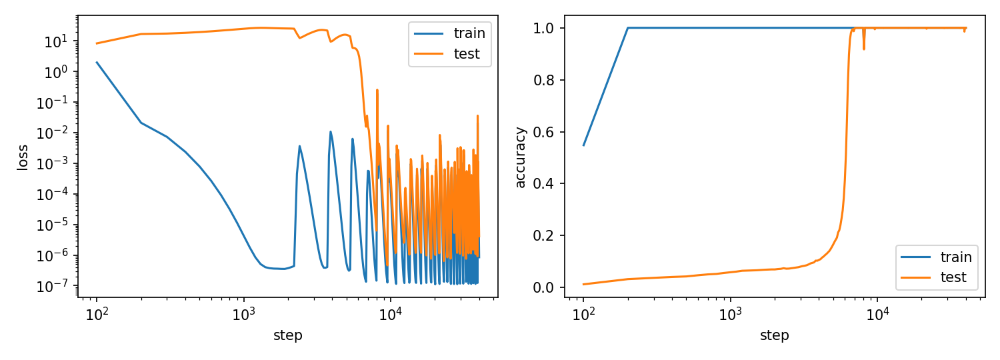
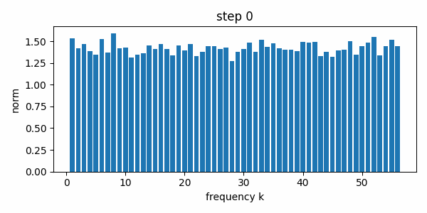
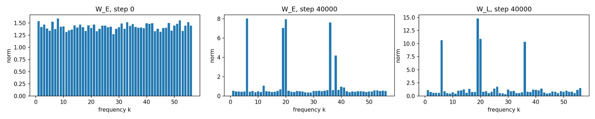
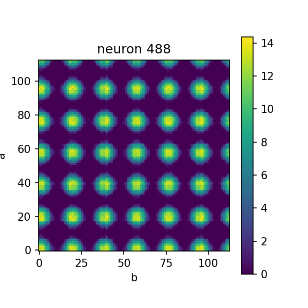

# grokking-from-scratch

[English](README.md) | 日本語

Nanda et al.（2023）*Progress measures for grokking via mechanistic interpretability* を、一から再現するリポジトリです。1層の Transformer に、113 を法とする加法を、全組の30%だけで学習させます。モデルは数百ステップで訓練データを丸暗記し、テストデータへの汎化は、それよりずっと後に急に起こります（grokking）。学習したネットワークが、少数の周波数を使って `a + b` を計算していることを示すフーリエ解析も含みます。

**現状：** データ、モデル、設定、学習ループ、フーリエ解析、図の作成のコードはすべて実装済みで、テストで確認しています。基準設定で 40,000 ステップの本番の学習を行い、汎化の遅れと、少数の周波数に集中するフーリエ構造の両方を再現しました（[結果](#結果)）。

## セットアップ

コマンドはすべて、リポジトリの直下で実行します。

```bash
python -m venv .venv
# Windows: .\.venv\Scripts\Activate.ps1    macOS/Linux: source .venv/bin/activate
python -m pip install torch numpy pandas matplotlib imageio pytest
python -m pytest tests -q
```

## 学習

```bash
python -m grokking.train --config configs/base.json
```

本番の学習は、Google Colab の GPU で行う想定です（`notebooks/01_train.ipynb`）。CPU では、2,000 ステップのスモーク実行（`configs/experiments/smoke.json`）に 242 秒、1ステップあたり約 0.12 秒かかりました。

実行の結果は `runs/<run_name>/` に書かれます。このフォルダは git の管理外です。

| ファイル | 内容 |
|---|---|
| `config.json` | 全設定と、コードの git コミットハッシュ |
| `metrics.csv` | `step, train_loss, train_accuracy, test_loss, test_accuracy, weight_sq_norm`（`log_every` ステップごと） |
| `ckpt_XXXXXX.pt` | 対数間隔のステップでのモデルの `state_dict`（1回の実行で約40個） |

## 設定

`configs/base.json` は論文の設定です。既定値は `grokking/config.py` の `Config` だけに書き、両者が一致することをテストで確かめています。

| キー | 値 | キー | 値 |
|---|---|---|---|
| `p` | 113 | `lr` | 1e-3 |
| `train_frac` | 0.3 | `weight_decay` | 1.0 |
| `d_model` | 128 | `betas` | (0.9, 0.98) |
| `n_heads` | 4 | `steps` | 40,000（フルバッチ、AdamW） |
| `d_mlp` | 512 | `log_every` / `n_checkpoints` | 100 / 40 |

`data_seed` が訓練/テストの分割を、`init_seed` が重みの初期値を決め、2つは互いに独立です。実験は、基準設定との差分だけを書いた小さな JSON で表します。知らないキーがあると、エラーになります。

```json
{"base": "../base.json", "weight_decay": 0.0, "run_name": "A_wd_0"}
```

## 解析と図

`notebooks/02_fourier_analysis.ipynb` は、チェックポイントを読み込み、埋め込み `W_E` と、ニューロンからロジットへの写像 `W_U W_out` のフーリエスペクトルを計算し、`grokking/analysis/plots.py` で図を作ります。

| 図 | 内容 |
|---|---|
| `figures/fig1_curve.png` | 損失と精度の曲線（横軸は対数） |
| `figures/fig2_spectrum.gif` | チェックポイントごとの埋め込みスペクトルの変化 |
| `figures/fig2_spectrum_before_after.png` | ステップ 0 の `W_E` と、学習後の `W_E`・`W_L` のスペクトル |
| `figures/fig3_neuron.png` | 1つの MLP ニューロンの、全 `(a, b)` に対する活性 |

ノートブックは図を Google Drive の `runs/base/figures/` に保存します。以下の図は、そこから `figures/` にコピーしたものです。

## 結果

基準設定（`configs/base.json`、`data_seed = init_seed = 0`）で、Colab の GPU を使い、フルバッチで 40,000 ステップ学習した1回の結果です。

### 図1：grokking の曲線



訓練精度はステップ 200 までに 100% になります。一方、テスト精度はステップ 4,000 前後まで約 10% 以下にとどまります。その後テスト精度は急に上がり、ステップ 7,000 ごろにはほぼ 100% に達し、学習の終わりまでその値を保ちます。テスト損失も、同じ区間で何桁も下がります。

訓練損失は単調には下がりません。ステップ 2,000 ごろから、1e-7 前後から 1e-3〜1e-2 まで跳ね上がっては戻ることを繰り返します。この跳ねは汎化を妨げていません。原因（損失が極端に小さい領域での float32 の精度か、損失面の鋭さか）は、まだ切り分けていません。

### 図2：埋め込みのフーリエスペクトル





ステップ 0 では、56 個の周波数がどれもほぼ同じ強さです。学習後は、埋め込み `W_E` が5つ前後の周波数に集中し、それ以外はほぼ 0 になります。ニューロンからロジットへの写像 `W_L = W_U W_out` は、そのうちの4つと同じ周波数にピークを持ちます。つまりネットワークは、入口でも出口でも共通の少数の周波数を使って `a + b` を扱っており、Nanda et al. の報告と一致します。

### 図3：MLP のニューロン



ニューロン 488（全入力に対する分散が最大のニューロン）は、`(a, b)` 平面の上で規則的な格子状に発火します。各軸に沿って6周期、つまり周期は 113/6 ≈ 19 で、これは図2のピークの1つである周波数 k = 6 に対応します。活性は `a` と `b` のそれぞれについて同じ周波数で周期的に変わっており、加法定理で `cos(ω_k(a + b))` を計算するのに必要な入力になっています。

## ディレクトリ構成

```
grokking/            data.py, model.py, config.py, train.py
grokking/analysis/   fourier.py, neurons.py, plots.py
configs/             base.json, experiments/*.json
notebooks/           01_train.ipynb, 02_fourier_analysis.ipynb（出力はクリア済み）
tests/               pytest のテスト
figures/             README に載せる図
docs/                spec.md（仕様）、notes.md（詰まったところと判断の記録）
```

## 参考文献

Nanda, Chan, Lieberum, Smith, Steinhardt (2023). Progress measures for grokking via mechanistic interpretability. ICLR 2023. arXiv:2301.05217.

Power, Burda, Edwards, Babuschkin, Misra (2022). Grokking: Generalization beyond overfitting on small algorithmic datasets. arXiv:2201.02177.

Liu, Michaud, Tegmark (2023). Omnigrok: Grokking beyond algorithmic data. arXiv:2210.01117.

Loshchilov, Hutter (2019). Decoupled weight decay regularization. arXiv:1711.05101.

## ライセンス

`LICENSE` を参照してください。